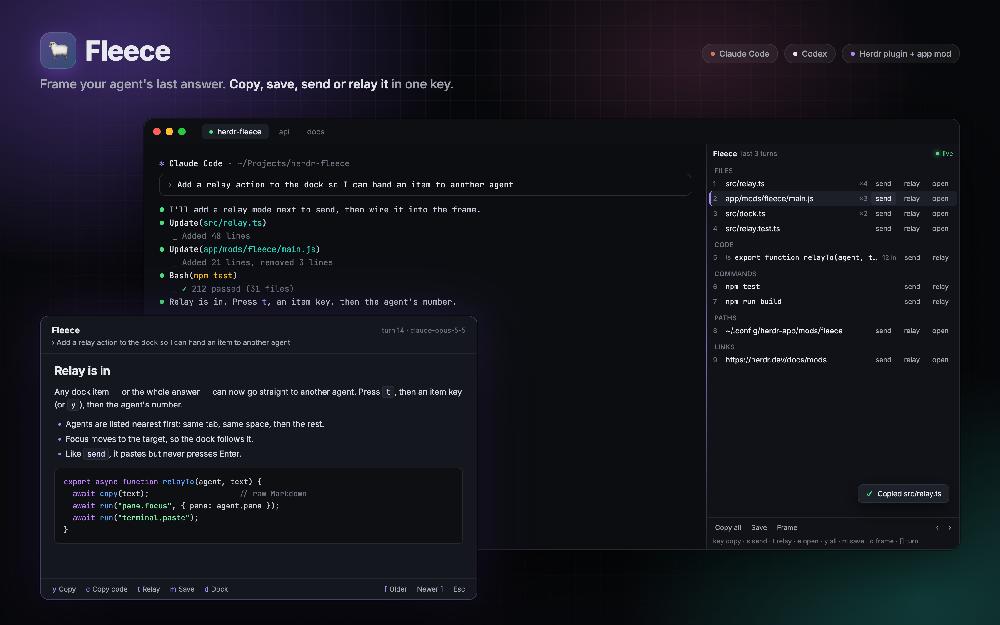

# 🐑 Fleece

[](https://github.com/dmazlum/herdr-fleece/actions/workflows/ci.yml)

Frame your agent's last answer in [Herdr](https://herdr.dev), then copy, save, or send it.



A coding agent writes its best prose once and then scrolls it away. Fleece reads the
session transcript — not the pane — and hands the answer back as raw Markdown.

Requires **Node 20+**, **Herdr 0.8.0+**, and a **Claude Code** or **Codex** session.

## Features

- **Frame.** Overlay the last answer on demand. `q` closes it. Copy, copy-code, or save
  without taking space from the agent pane.
- **Dock.** A narrow pane that lists files the agent edited, plus code, commands, paths,
  and links from the last few turns. One keystroke copies; `s` then a key sends; `t` then
  a key relays it to another agent; `e` then a key opens a file, path, or link.
- **Journal.** Optionally write every answer to disk as Markdown as it lands.
- **Clipboard.** Local tools (`pbcopy`, `wl-copy`, `xclip`, `xsel`) and OSC 52 over SSH.

## Herdr app

The [Herdr desktop app](https://herdr.dev) does not run Herdr plugins. It has mods
instead, and Fleece ships one in [`app/`](app/): the same dock and frame, drawn natively.
The transcript parsing is the same code, bundled into `app/mods/fleece/engine.mjs` and run
with your Node.

```sh
git clone https://github.com/dmazlum/herdr-fleece
cp -R herdr-fleece/app/mods/fleece herdr-fleece/app/mods/fleece-dock ~/.config/herdr-app/mods/
herdr-app check ~/.config/herdr-app/mods/fleece
```

Then merge [`app/keys.json`](app/keys.json) into `~/.config/herdr-app/keys.json`:

| Key / command | What it does |
| --- | --- |
| `cmd-shift-f` → `mod.open:fleece` | Frame the focused agent's last answer |
| `cmd-alt-f` → `mod.open:fleece-dock` | Toggle the dock beside the focused agent |
| `d` in the frame | Dock Fleece beside that agent |
| `herdr-app do pane.split --direction right --mod fleece` | The same dock, from a shell |
| `cmd-shift-y` → `fleece.copy` | Copy the last answer (with a dock shown) |

In the dock, click a row to copy it, or use its send and relay buttons. Its keys match
the plugin's (item key, `s`, `t`, `e`, `y`, `m`, `o`, `[`/`]`, `r`). The frame takes `y`,
`c`, `t` (relay the answer), `m`, `d`, `[`/`]` and Esc. Configuration is read from
`~/.config/fleece/config.toml` (or `$FLEECE_CONFIG_DIR`), with the same keys as below.
Claude Code and Codex agents on this machine are supported.
[`app/RECIPE.md`](app/RECIPE.md) covers the details.

## Agents

Fleece finds the transcript from the session Herdr reports for the pane.

| Agent | Transcripts | Setting |
| --- | --- | --- |
| Claude Code | `~/.claude/projects/<folder>/<session>.jsonl` | `CLAUDE_CONFIG_DIR` |
| Codex | `~/.codex/sessions/YYYY/MM/DD/rollout-…-<session>.jsonl` | `CODEX_HOME` |

If Herdr has reported no session for the pane, Fleece falls back to the newest transcript
for the pane's folder. Two sessions in one folder share that guess, so `fleece doctor`
marks it as `(guessed from folder)`.

## Install

```sh
herdr plugin install dmazlum/herdr-fleece
```

Or, while developing:

```sh
git clone https://github.com/dmazlum/herdr-fleece
cd herdr-fleece && npm ci && npm run build
herdr plugin link .
```

Herdr binds no keys by default. Add to `~/.config/herdr/config.toml`:

```toml
[[keys.command]]
key = "prefix+f"
type = "plugin_action"
command = "fleece.frame"
description = "frame last answer"

[[keys.command]]
key = "prefix+shift+f"
type = "plugin_action"
command = "fleece.dock"
description = "toggle fleece dock"

[[keys.command]]
key = "prefix+y"
type = "plugin_action"
command = "fleece.copy"
description = "copy last answer"
```

After a rebuild, toggle the dock off and on — an open pane keeps the modules it loaded
at startup. Headless actions (`copy`, `save`, `journal`) always run the new build.

## Updates

Herdr updates its own mods, not ones you added: yours is a copy, and nothing tells you
when this repo changes. To hear about a new version, watch the repo for releases (on
GitHub: **Watch → Custom → Releases**). Each
[release](https://github.com/dmazlum/herdr-fleece/releases) says what changed and whether
`keys.json` did; merge it again when it did.

The terminal plugin updates with `herdr plugin update fleece`; `herdr plugin list`
shows the version you have.

The app mods don't update by themselves. The version you have is `"version"` in
`~/.config/herdr-app/mods/fleece/mod.json`. To update, ask your agent to replace the
`fleece` and `fleece-dock` folders with the latest `app/mods/` ones from
`github.com/dmazlum/herdr-fleece` (adding them again isn't enough: an agent never
overwrites a mod, it would add second copies under new names), or by hand:

```sh
git -C herdr-fleece pull           # or clone it again
rm -rf ~/.config/herdr-app/mods/fleece ~/.config/herdr-app/mods/fleece-dock
cp -R herdr-fleece/app/mods/fleece herdr-fleece/app/mods/fleece-dock ~/.config/herdr-app/mods/
herdr-app check ~/.config/herdr-app/mods/fleece
```

## Frame

`fleece.frame` opens the last answer in an overlay. It renders Markdown for reading;
`copy` and `save` always use the raw source.

| Key | Action |
| --- | --- |
| `y` | Copy the answer |
| `c` | Copy fenced code only |
| `m` | Save as Markdown |
| `j`/`k`, arrows, `PgUp`/`PgDn` | Scroll |
| `g`/`G` | Top / bottom |
| `q`, `Esc` | Close |

## Dock

`fleece.dock` splits a list beside the focused agent and never takes focus. It follows
pane focus and refreshes when that agent goes idle. Press `o` for the frame when the
list is not enough.

```
┌─ Fleece ── last 3 turns ────────────────┐
│ FILES                                   │
│  1 app/Models/Shipment.php           ×4 │
│  2 database/migrations/…_add_eta.php    │
│ CODE                                    │
│  3 public function up(): void     12 ln │
│ COMMANDS                                │
│  4 php artisan migrate                  │
│ LINKS                                   │
│  5 herdr.dev/docs/socket-api/           │
├─────────────────────────────────────────┤
│ key copy · s send · e open         live │
│ y all · m save · [ ] turn · q close     │
└─────────────────────────────────────────┘
```

What gets listed:

- **FILES** — from the agent's own edits: Claude Code's `Write`, `Edit`, `MultiEdit`, and
  `NotebookEdit` calls, or Codex's applied patches. Reads, deleted files, and patches that
  failed are omitted. The clipboard gets the absolute path.
- **CODE** — fenced blocks with a language tag, or contents that look like source.
- **PATH** — mentioned paths that exist on disk, after FILES has claimed the edited ones.
- **COMMAND** — runnable lines. A command shown with its result (`npm test → 70 passing`)
  is left out.

With Codex, the answer is its final message; the progress notes it writes between tool
calls are left out.

`[` / `]` walks that window back through the session. `y`, `m`, and `o` follow the
window. A new turn does not move a window you have paged away from.

| Key | Action |
| --- | --- |
| `1`–`9`, leftover letters | Copy that item |
| `s` then an item key | Send to the pane you came from (Esc cancels) |
| `t` then an item key or `y`, then a number | Relay the item, or the whole answer, to another agent |
| `e` then an item key | Open a file, path, or link (Esc cancels) |
| `y` | Copy the whole answer |
| `m` | Save as Markdown |
| `o` | Open the frame |
| `[` / `]` | Older / newer turns |
| `r` | Reload |
| `j`/`k` | Scroll |
| `q`, `Esc` | Close |

Open hands files and directories to the system opener (`open` on macOS, `xdg-open` on
Linux), or to `open_command` if set. Links always go to the default browser. Code and
commands have nothing to open.

Send uses a bracketed paste and never presses Enter. Control bytes are stripped so a
payload cannot break the paste wrap.

Relay carries something from the followed agent to a different one, without the dock
switching to that agent's list. `t` asks for an item key, or `y` for the whole answer,
then lists the other agents nearest first (same tab, same workspace, the rest) and takes
a number. With only one other agent it goes straight there. It pastes the same way as
send, so the receiving agent waits until you press Enter.

## Commands

| Action | What it does |
| --- | --- |
| `fleece.frame` | Open the last answer in an overlay |
| `fleece.dock` | Toggle the dock beside the focused agent |
| `fleece.copy` | Copy the last answer |
| `fleece.copy-code` | Copy fenced code blocks only |
| `fleece.save` | Write the last answer to the export directory |
| `fleece.journal` | Write every unsaved answer in this session |
| `fleece.doctor` | Print what Fleece resolves from here |

From a shell, after `npm run build`:

```sh
node dist/cli.js frame --print
node dist/cli.js frame --json
node dist/cli.js copy --code
node dist/cli.js save --turn 12
node dist/cli.js doctor
```

## Configuration

`herdr plugin config-dir fleece` prints the directory. Create `config.toml` there:

```toml
export_dir       = "~/Documents/fleece"
include_prompt   = true
include_thinking = false
front_matter     = true
journal          = false
dock_turns       = 3
dock_width       = 46
open_command     = "code -r"   # optional; files and paths only

[keys]
close       = "q"
down        = "j"
up          = "k"
page_down   = " "
top         = "g"
bottom      = "G"
reload      = "r"
send        = "s"
relay       = "t"
open        = "e"
older       = "["
newer       = "]"
frame       = "o"
copy_answer = "y"
save        = "m"
```

A binding is one character. Hint rows and item-pick keys are derived from this table.
`fleece doctor` prints the bindings in force and anything it ignored. Escape, Ctrl+C,
arrows, and Page Up/Down are not bindable.

With `journal = true`, the dock writes new answers as they land. `fleece.journal`
backfills a session, including one the dock never saw. Files are named by project,
session, turn, and time; an existing file is left alone. The latest answer is written
once the agent is idle and its transcript has been quiet for a second, so a turn still
in progress never leaves a partial copy behind; `fleece.journal` reports it as still in
progress.

## License

MIT
