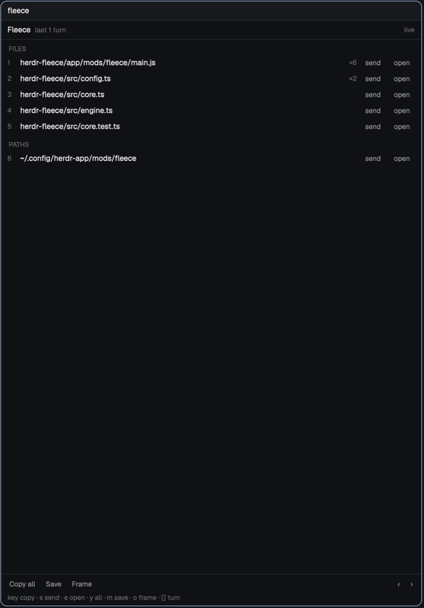

# Fleece

Fleece pulls things out of a Claude Code agent's answers. A dock pane next to the agent
lists the files it edited, plus the code, commands, paths and links from its last few
turns. Click a row to copy it. A frame dialog shows the whole answer as rendered Markdown.
Copy and save always use the raw Markdown from the session transcript, not the terminal
screen.

## What you see

- **Dock** (a mod pane, usually to the right of the agent). It uses the theme's `chrome`
  background and 12px UI text.
  - A 30px header: **Fleece** (semibold), the window label in `dim` ("last 3 turns", or
    "turn 12 · 2 back" when paged back), and `live` (`idle` color) or `pinned`
    (`blocked` color) on the right.
  - Sections in a fixed order: FILES, CODE, COMMANDS, PATHS, LINKS. Each title is 10.5px
    `dim`. Rows are 24px. Each row shows its pick key (`1`–`9`, then letters not bound to
    a command), an optional tag (the fence language), a truncated label (monospace for
    code and commands), an optional detail (`×4` edits, `12 ln`), then `send` and, for
    files, paths and links, `open` buttons.
  - A footer with Copy all, Save and Frame buttons, `‹ ›` for turns, and a one-line key
    hint. While `s` or `e` is waiting for an item key, the hint switches to the `accent`
    color.
- **Frame**: a dialog at 70%×85% of the window, on `popover`. The header shows **Fleece**,
  `turn N · model`, and the first line of the prompt. The body is the answer, rendered
  with `TextView.markdown` and selectable. The footer has `y Copy`, `c Copy code`,
  `m Save`, `d Dock`, `[ Older`, `Newer ]` and `Esc`.

## How it behaves

- The dock follows the focused agent terminal. When a mod pane (or anything that isn't an
  agent) takes focus, it keeps the last agent. With nothing to follow, it uses the first
  agent in the shown tab.
- It re-reads the transcript when the followed agent or its status changes. While the
  agent is `working`, it holds the last good list. It reads again once the agent goes
  `idle`, `done` or `blocked`.
- Keys while the dock has focus: an item key copies that item. `s` then an item key
  sends it. `e` then an item key opens it. `y` copies the whole answer, `m` saves it,
  `o` opens the frame, `[`/`]` page through answers, `r` reloads, and Esc cancels a
  pending `s`/`e`. Keys come from `~/.config/fleece/config.toml` `[keys]`, the same table
  the Herdr plugin uses.
- **Send** copies the item, focuses the agent's terminal, and runs `terminal.paste`. It
  never presses Enter.
- **Open** passes files and paths to `open`/`xdg-open`, or to `open_command`. Links
  always go to the browser.
- Paging back pins the window to that answer, so a new turn doesn't move it. Stepping
  onto the newest answer goes live again.
- With `journal = true`, every dock refresh writes answers that aren't on disk yet.

## Built from

- `mods/fleece/main.js` is one `View` with two shapes. `props().overlay` set means the
  frame; otherwise it's the dock. The frame takes `props().terminal` and `props().pin`
  from the dock, or the focused agent when it's opened with `mod.open:fleece`.
- `mods/fleece-dock/main.js` toggles the dock (`mod.open:fleece-dock`, bound to `cmd-alt-f`).
  A key can only run a command, and a closed dock has no copy to receive one, so it opens
  as a 2×2 frameless popup, closes the tab's `fleece` panes or splits one right of the
  agent's pane, refocuses the agent and closes itself.
- `mods/fleece/engine.mjs` is a bundled Node script (Node 20+). The mod runs it with
  `exec("node", [appHome() + "/mods/fleece/engine.mjs", ...])` and reads one JSON line
  back. Its commands are `state`, `copy`, `clip`, `save`, `journal`, `open` and `doctor`,
  each with `--terminal tN`.
- The engine resolves the terminal like this: `hc get tN --json` gives the foreground
  pid, then `~/.claude/sessions/<pid>.json` gives the `sessionId`, then
  `~/.claude/projects/*/<sessionId>.jsonl`. If there's no session file, it falls back to
  the newest transcript for the cwd.
- herdr calls used: `agents()`, `focused()`, `panes()`, `exec`, `openOverlay`,
  `closeOverlay`, `notify`, `nextCommand` (`fleece.copy`, `copy-code`, `save`,
  `journal`, `frame`, `reload`), and `run("pane.focus" | "terminal.paste" | "pane.split")`.
- Programs it runs: `node`, `hc`, and `pbcopy`/`wl-copy`/`xclip`/`xsel`.

## Watch out

- The mod reaches outside its folder. It reads `~/.claude`, runs `node` and `hc`, writes
  exports to `export_dir` (default `~/Documents/fleece`), and writes the clipboard.
- Only Claude Code on this machine is supported. Agents on another machine (`vps/t7`)
  show a notice.
- `exec` has a 30s limit and 8 MiB of output. The engine returns only one window of
  answers.
- `<mod>.<command>` keys reach a shown dock only.
- Send replaces the clipboard with the item it sends.

## Done when

- `herdr-app check ~/.config/herdr-app/mods/fleece` passes.
- `herdr-app do pane.split --direction right --mod fleece` beside a Claude Code agent
  lists the files it edited in its last turns.
- `mod.open:fleece` over that agent renders its last answer, and `y` puts the raw
  Markdown on the clipboard (`pbpaste`).
- `m` writes a `.md` file under `~/Documents/fleece`.
